# Grosary CRM

A grocery-store operations CRM with a role-protected Node.js/TypeScript REST API, PostgreSQL, and a responsive Flutter app. Use one workspace to review sales, ring up customers, manage products and inventory, receive purchasing, and oversee stores and staff.

> This is an early-stage development foundation, not production-ready retail or accounting software. Integrations for live card/UPI collection, WhatsApp, email, and PDF invoice generation are **not implemented**.

## Product tour and downloads

The interactive tour documents **all 16 frontend sections**, with an illustrative screen, typical workflow, feature summary, and important operational notes:

- **Inline animated walkthrough:** watch all 16 sections, including the full sidebar and header, right here in the README. Select the animation to open the complete video.

| Complete interface walkthrough (loops inline) |
|---|
| [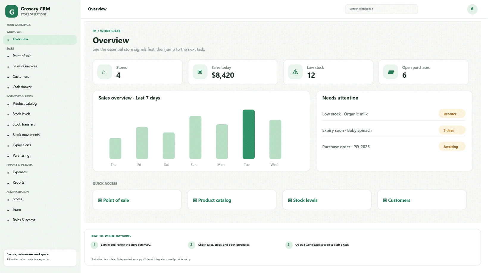](greenbasket-complete-product-tour.webm) |

- [Open the interactive product tour](grocery-crm-product-tour.html)
- [Download or play the complete section-by-section video](greenbasket-complete-product-tour.webm) (silent WebM video)
- [Download all screen images as a PNG bundle](greenbasket-all-16-screen-images.zip)
- Screenshots are also individually available in [docs/screenshots](docs/screenshots/).

The looping image and video show every screen and the complete navigation sidebar and header. Screen content uses illustrative sample data; it is not a live store, API response, or actual transaction.

## Screenshots

### Workspace and sales

| Overview | Point of sale |
|---|---|
| 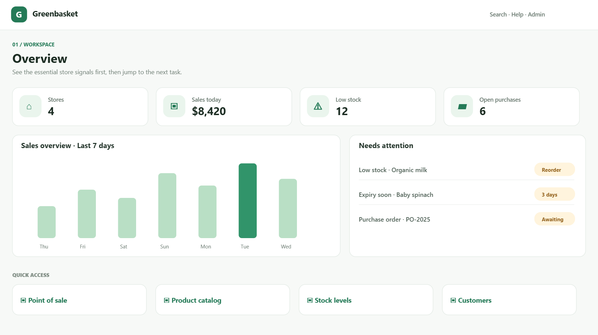 | 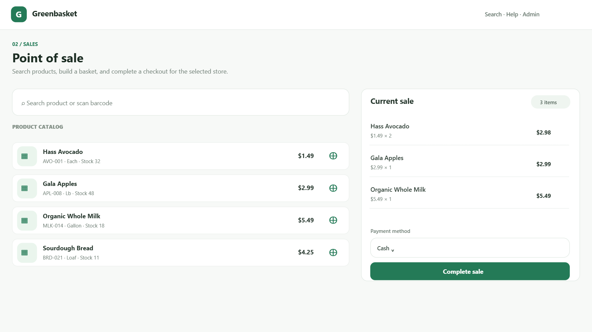 |

| Sales & invoices | Customers |
|---|---|
| 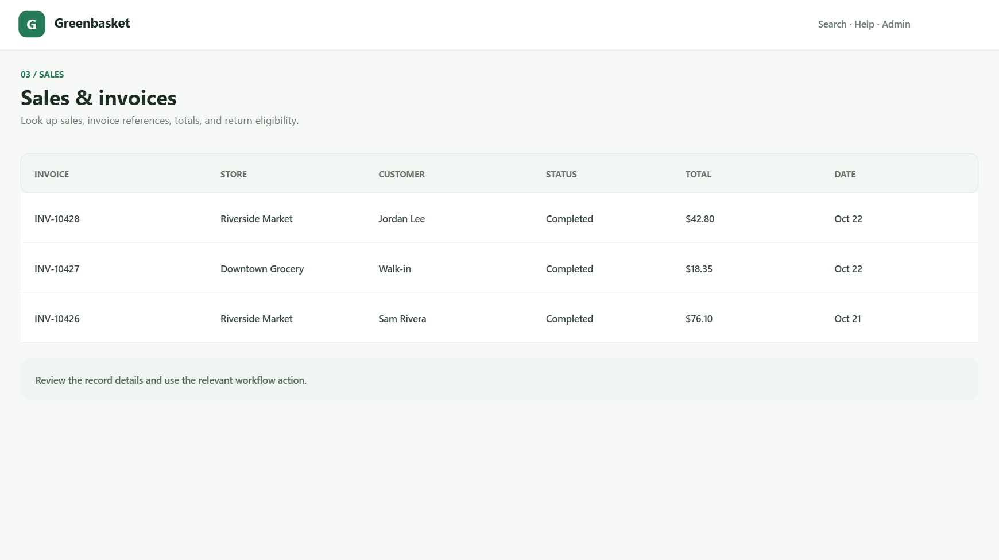 | 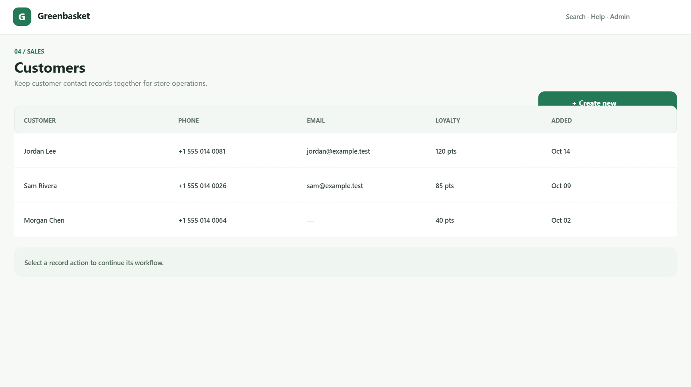 |

| Cash drawer | |
|---|---|
| 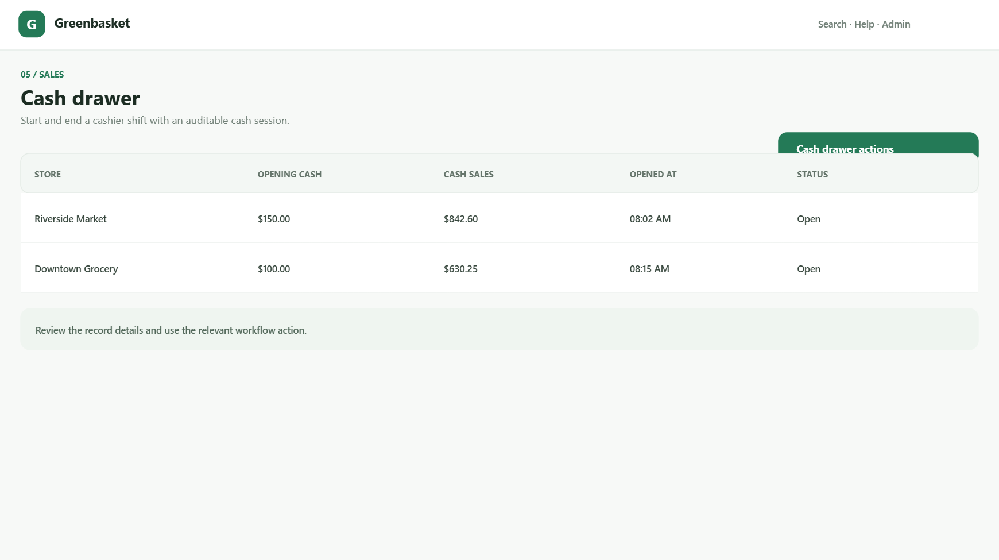 | |

### Inventory and supply

| Product catalog | Stock levels |
|---|---|
| 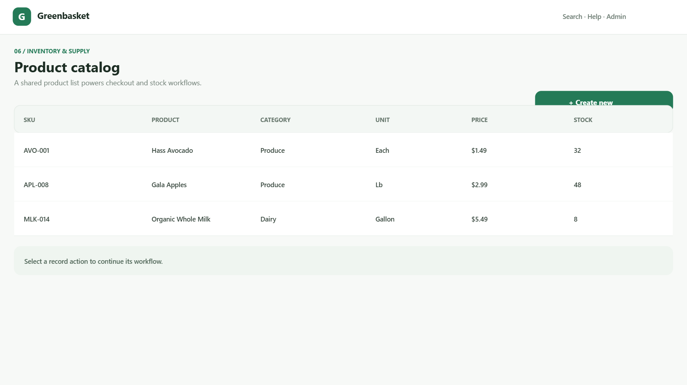 | 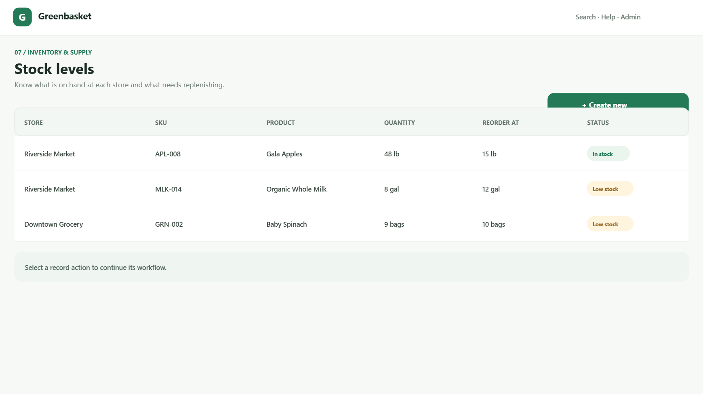 |

| Stock transfers | Stock movements |
|---|---|
| 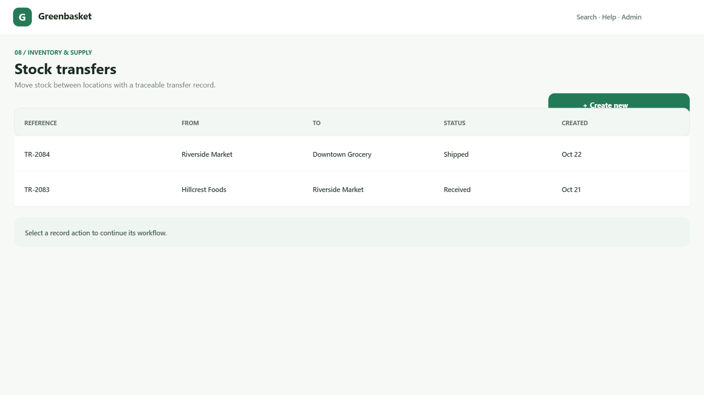 | 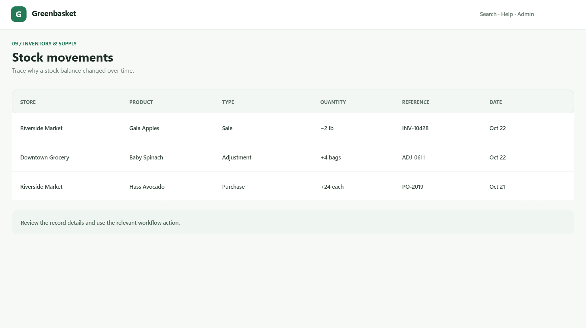 |

| Expiry alerts | Purchasing |
|---|---|
| 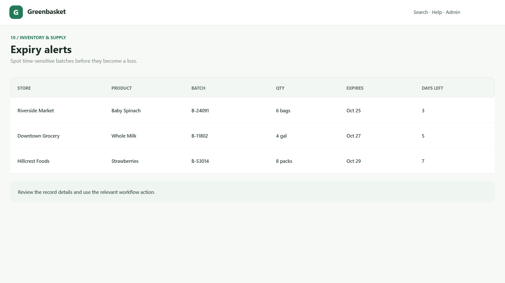 | 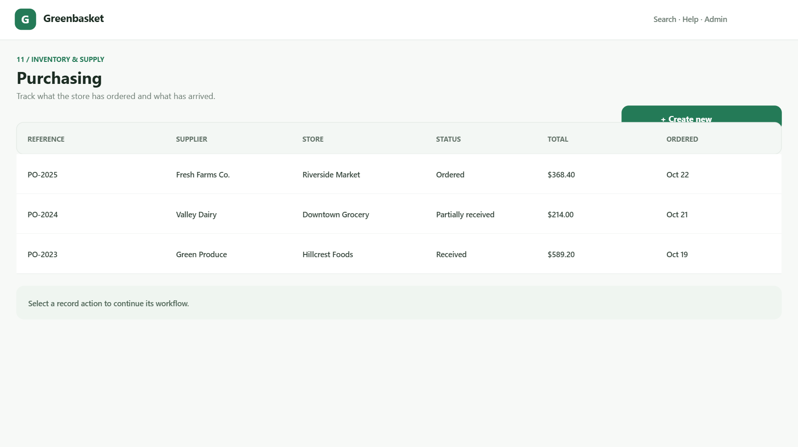 |

### Finance and administration

| Expenses | Reports |
|---|---|
| 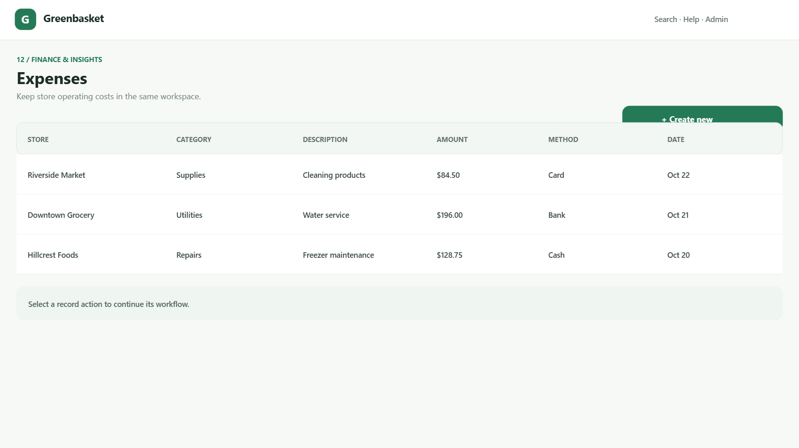 | 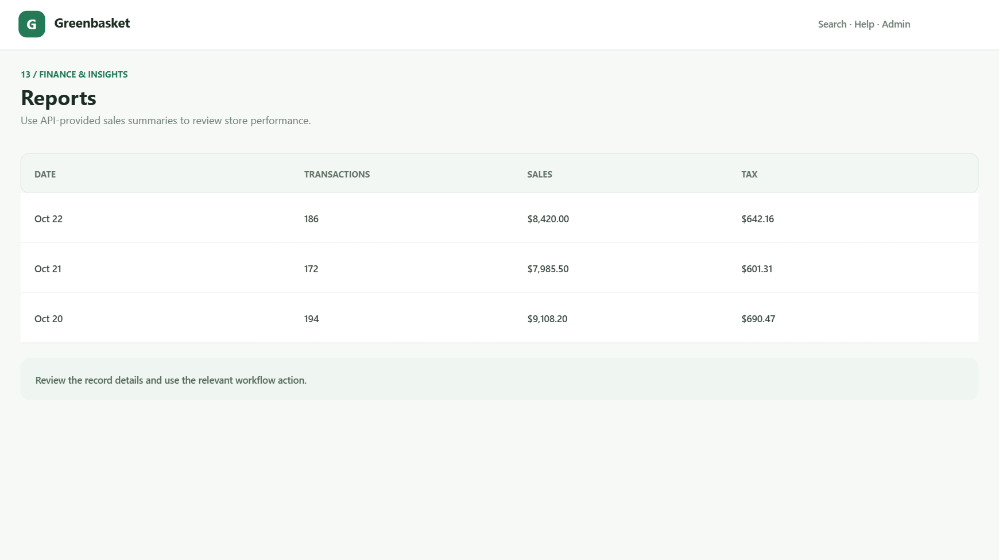 |

| Stores | Team |
|---|---|
| 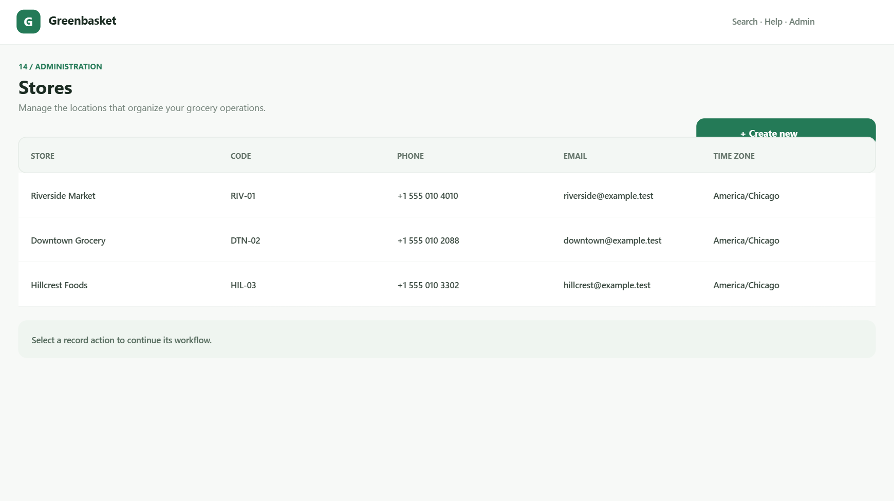 | 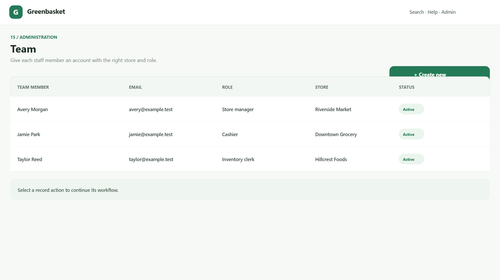 |

| Roles and access | |
|---|---|
| 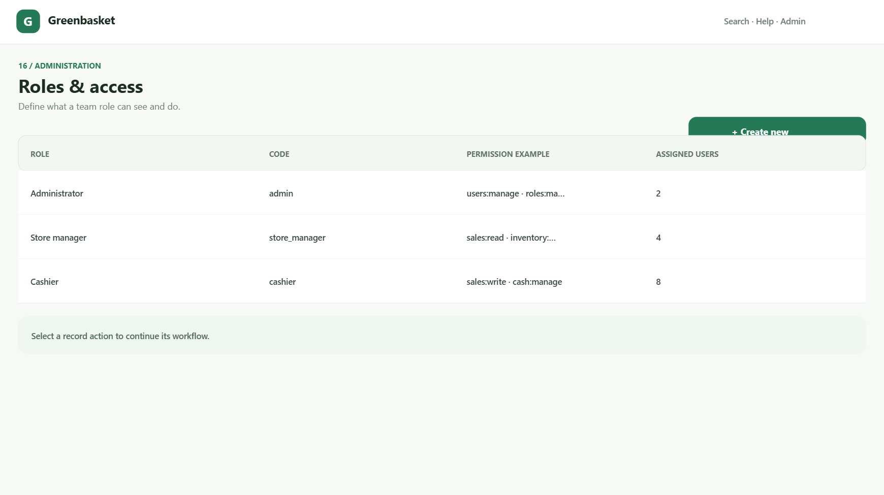 | |

## App sections

| Section | What it's for |
|---|---|
| Overview | API-provided store, sales, low-stock, and pending-purchase metrics; navigation to common tasks. |
| Point of sale | Search products, build a basket, choose a recorded payment method, check out, and receive the invoice number. |
| Sales & invoices | Review recorded sales and invoice details; start eligible returns if the signed-in user has permission. |
| Customers | Create and review basic customer contact and loyalty-point records. |
| Cash drawer | Open and close a store cash session and enter the counted cash amount. |
| Product catalog | Manage product SKU, name, category, unit, cost, selling price, tax, and optional barcode. |
| Stock levels | Review stock by store and record a reasoned adjustment. |
| Stock transfers | Create inter-store transfers and record receipt for eligible shipments. |
| Stock movements | Inspect stock changes and their operational references. |
| Expiry alerts | Review tracked batches approaching their expiry date. |
| Purchasing | Create supplier orders and receive eligible ordered quantities. |
| Expenses | Record store expenses with category, description, amount, and payment method. |
| Reports | Review the available daily sales, transaction-count, and tax totals. |
| Stores | Create and review store locations. |
| Team | Create staff accounts and manage activation status, role, and store assignment. |
| Roles & access | Define role names/codes and the permission codes assigned to a role. |

Available navigation is filtered by the signed-in account's permissions for usability. **Backend authorization remains the security boundary** and protects each restricted route.

## Architecture

```text
grosarycrm/
├── backend/              Node.js + TypeScript REST API
│   ├── migrations/       PostgreSQL migrations
│   └── src/              API routes, auth, domain and database modules
├── frontend/             Flutter app with flutter_bloc Cubits
│   └── lib/features/     Authentication, dashboard and point of sale
├── docs/screenshots/     Sixteen illustrative screen images
├── grocery-crm-product-tour.html
└── greenbasket-complete-product-tour.webm
```

The app packages are independently runnable. PostgreSQL schema changes are tracked as additive migrations in `backend/migrations/`. Database calls use parameterized queries.

## Requirements

- Node.js 20+ and npm
- PostgreSQL 15+
- Flutter stable and its Dart SDK

## Run the backend

Create a local PostgreSQL database (for example, `grocery_crm`), then in PowerShell:

```powershell
cd backend
Copy-Item .env.example .env
```

Update `backend/.env` with your local `DATABASE_URL` and a **private, random** `JWT_SECRET`, then run:

```powershell
npm install
npm run db:migrate
npm run db:seed
npm run dev
```

The API defaults to `http://localhost:3000`; health is available at `GET /health`, and application routes are under `/api/v1`. The local seed creates `admin@grocery.local` with password `ChangeMe123!`. This example credential is public with the source: replace it immediately, do not reuse it, and never expose a seeded environment to the internet.

### Backend scripts

| Script | Purpose |
|---|---|
| `npm run dev` | Run the API with `tsx` watch mode. |
| `npm run db:migrate` | Apply tracked PostgreSQL migrations. |
| `npm run db:seed` | Create local development seed records. |
| `npm test` | Run the current backend test suite. |
| `npm run build` | Compile TypeScript into `backend/dist/`. |
| `npm start` | Run the compiled server. |

## Run the Flutter app

In a second PowerShell window:

```powershell
cd frontend
flutter pub get
flutter run --dart-define=API_BASE_URL=http://localhost:3000/api/v1
```

For Android emulators, use `http://10.0.2.2:3000/api/v1` instead of `localhost`. On a physical device, use the development computer's reachable LAN address. To check the Flutter package, run `flutter analyze` and `flutter test` from `frontend/`.

## API and feature scope

Authentication and the dashboard summary are implemented. Backend route modules cover catalog, customers, inventory, operations, purchasing, reports, sales, stores, administration, and dashboard workflows. The migration contains data structures for grocery operations including catalog, inventory, purchase, customer, sales, invoice, payment, and audit records.

The frontend currently connects to these read and workflow APIs; the database schema does **not** mean every possible CRUD operation or report has been implemented. The product tour explains each available section and its current scope.

## External services: important limitations

- Cash, card, UPI, and other tender values recorded during checkout are CRM records, **not proof of a live payment**.
- Razorpay/Stripe collection and refunds, email delivery, WhatsApp messaging, and generated PDF invoices are **not implemented provider integrations**.
- `backend/src/integrations/providers.ts` defines interfaces only. A provider requires its own adapter, provider account, secret configuration, error handling, and required security checks before it can be used.
- Invoice APIs return invoice data; they do not create an invoice PDF.
- Never commit real API keys, passwords, tokens, customer records, or production data. `.env` files are ignored by Git; keep real credentials in deployment secrets.

## Contributing and readiness

Keep business rules and authorization in the API, use the existing `flutter_bloc` and repository patterns, and make schema changes as tracked PostgreSQL migrations. Before a real deployment, review roles and tax rules; replace the development seed credentials; configure HTTPS, private secrets, backups, monitoring, rate limiting, and session revocation; and implement, security-review, and test any provider integrations.
